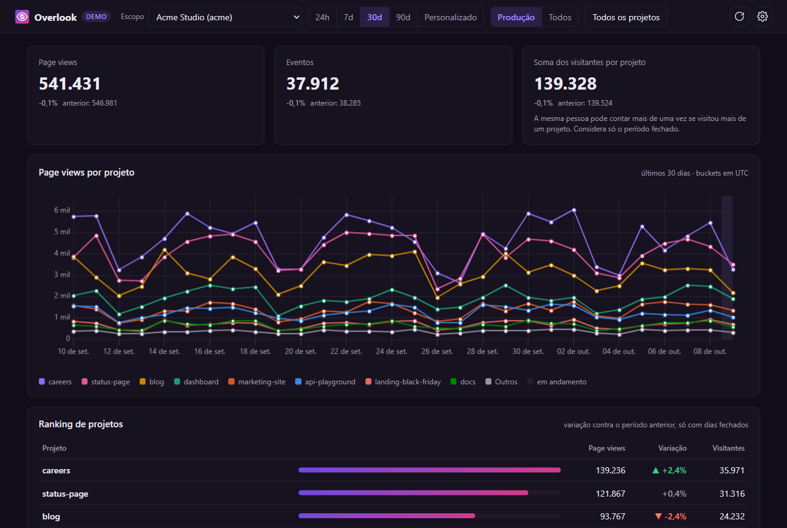
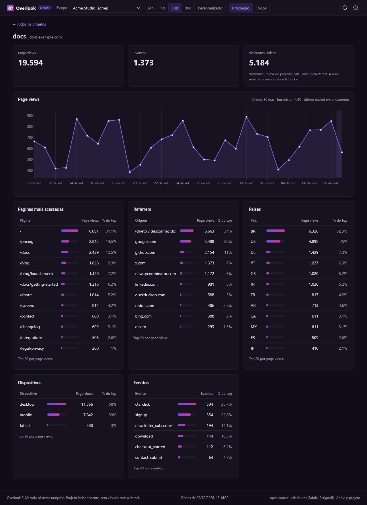
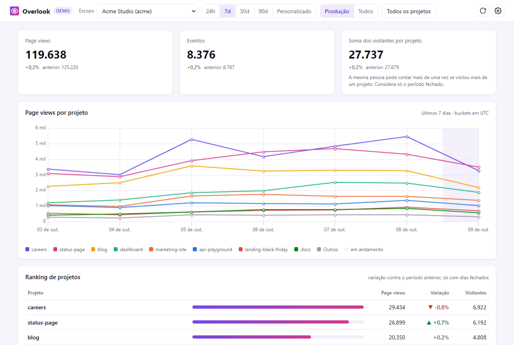

<p align="center">
  
</p>

<h1 align="center">Overlook</h1>

<p align="center">
  <strong>Vercel Web Analytics for all your projects, in one local dashboard.</strong>
</p>

<p align="center">
  <a href="https://github.com/Serignolli/overlook/actions/workflows/ci.yml"></a>
  <a href="https://github.com/Serignolli/overlook/releases/latest"></a>
  <a href="LICENSE"></a>
  
</p>

<p align="center">
  <a href="https://overlook.serignolli.com">Website</a> ·
  <a href="https://github.com/Serignolli/overlook/releases/latest">Download</a> ·
  <a href="#privacy">Privacy</a> ·
  <a href="CONTRIBUTING.md">Contributing</a>
</p>

---

The Vercel dashboard shows Web Analytics one project at a time. **Overlook puts every project in your account or team side by side**: page views, visitors, top pages, countries, referrers, devices and custom events.

It runs entirely on your machine and talks to Vercel only through **your own Vercel CLI** (`vercel metrics`). No account, no server in the middle, no telemetry.



> Independent open source project, not affiliated with Vercel. "Vercel" is a trademark of Vercel Inc.

## Contents

- [Features](#features)
- [Download](#download)
- [Requirements](#requirements)
- [Usage](#usage)
- [Privacy](#privacy)
- [How the numbers work](#how-the-numbers-work)
- [Limitations](#limitations)
- [Build from source](#build-from-source)
- [Repository layout](#repository-layout)
- [Contributing](#contributing)
- [License](#license)

## Features

- **Consolidated view** of every project in a personal account or team: totals with change against the previous period, and a chart with one line per project.
- **Project ranking** showing who grew, who dropped and who stopped getting visits. Projects with no data are flagged, so you can check whether Web Analytics is enabled.
- **Project view** with top pages, referrers, countries, devices and custom events, one click away from the ranking.
- **Flexible periods**: 24 hours, 7, 30 or 90 days, or a custom range; production only or all environments.
- **Shareable state**: scope, period, environment and selected projects live in the URL, so a favorite view is just a bookmark.
- **Light and dark themes.**
- **Demo mode** (`--demo`) with fake data, no CLI or Vercel account needed.
- **Self-contained packages** for Windows, macOS and Linux with a bundled Java runtime.

<table>
  <tr>
    <td></td>
    <td></td>
  </tr>
  <tr>
    <td align="center"><sub>Project view</sub></td>
    <td align="center"><sub>Light theme</sub></td>
  </tr>
</table>

## Download

Grab the latest build for your OS from the [Releases](https://github.com/Serignolli/overlook/releases/latest) page. Each package bundles its own Java runtime, so there is nothing else to install.

| Platform | File |
|---|---|
| Windows (x64) | `overlook-windows-x64.zip` |
| macOS (Apple Silicon) | `overlook-macos-arm64.zip` |
| macOS (Intel) | `overlook-macos-x64.zip` |
| Linux (x64) | `overlook-linux-x64.tar.gz` |
| Any OS with Java 21+ | `overlook.jar` |

Each file has a `.sha256` checksum next to it.

**First run.** The packages are not code-signed yet:

- **Windows:** unzip and open `Overlook.exe`. If SmartScreen appears, click *More info → Run anyway*.
- **macOS:** unzip, move `Overlook.app` to Applications, then right-click it and choose *Open* the first time.
- **Linux:** `tar xzf overlook-linux-x64.tar.gz && ./Overlook/bin/Overlook`

Overlook starts at `http://127.0.0.1:7878` and opens a browser tab. A tray icon offers *Open dashboard* and *Quit*; there is also a quit button in the settings.

## Requirements

- [Vercel CLI](https://vercel.com/docs/cli), installed and logged in:

  ```bash
  npm i -g vercel
  vercel login
  ```

- [Web Analytics enabled](https://vercel.com/docs/analytics/quickstart) on each project you want to see.

Web Analytics is queryable through `vercel metrics` without Observability Plus.

## Usage

```bash
overlook                 # http://127.0.0.1:7878
overlook --port 9000     # another port
overlook --demo          # fake data, no CLI or account needed
overlook --no-browser    # don't open a browser tab
overlook --version
overlook --help
```

With the portable JAR: `java -jar overlook.jar [flags]`.

**Configuration.** Settings live in `~/.overlook/config.json` (`%APPDATA%\overlook\config.json` on Windows) and can be edited from the settings dialog. Command-line flags override the file without changing it. Logs go to `logs/overlook.log` in the same folder.

## Privacy

Overlook never touches credentials. Authentication belongs to the Vercel CLI, and the only outbound traffic is the CLI talking to Vercel.

1. **Auth is delegated to the CLI.** Overlook never reads the CLI's credential file. If `VERCEL_TOKEN` is set, it is passed to the subprocess only as an environment variable.
2. **Never `--token` on the command line.** `CliRunner` refuses it, because arguments show up in the process list.
3. **No network of its own.** There is no HTTP client in the code; an ArchUnit test enforces it.
4. **Loopback only.** The server binds to `127.0.0.1` with no option to change it, validates the `Host` header against DNS rebinding, and requires a per-launch CSRF token for any state-changing request.
5. **Zero telemetry.** No analytics, crash reporting or update checks. The CLI's own telemetry is disabled for its subprocess (`VERCEL_TELEMETRY_DISABLED=1`).
6. **Clean logs.** CLI output goes through a filter that masks anything that looks like a token.
7. **Local assets.** No CDN, fonts or external scripts in the dashboard. CSP is `default-src 'self'`.

### How to audit

| What | Where |
|---|---|
| How the CLI is run (arguments, environment, timeout) | [`vercel/CliRunner.java`](src/main/java/dev/overlook/vercel/CliRunner.java) |
| How the CLI is found (on Windows, `node vc.js` instead of `cmd.exe`) | [`vercel/CliLocator.java`](src/main/java/dev/overlook/vercel/CliLocator.java) |
| Which CLI commands are called | [`vercel/CliVercelGateway.java`](src/main/java/dev/overlook/vercel/CliVercelGateway.java) |
| Secret masking in logs | [`vercel/SecretMasker.java`](src/main/java/dev/overlook/vercel/SecretMasker.java) |
| Loopback bind, CSP and headers | [`web/WebServer.java`](src/main/java/dev/overlook/web/WebServer.java) |
| Host and CSRF checks | [`web/HostGuard.java`](src/main/java/dev/overlook/web/HostGuard.java), [`web/CsrfGuard.java`](src/main/java/dev/overlook/web/CsrfGuard.java) |
| Architecture rules (no outbound HTTP, only the gateway runs processes) | [`arch/ArchitectureTest.java`](src/test/java/dev/overlook/arch/ArchitectureTest.java) |

**Environment passed to the CLI:** `VERCEL_TOKEN` and `PATH`, plus what the CLI and Node need to work: user folders (`HOME`, `USERPROFILE`, `APPDATA`, `LOCALAPPDATA`, `XDG_*`), `SystemRoot`, `TEMP`/`TMP`, `PATHEXT`, `ComSpec`, proxies (`HTTP(S)_PROXY`, `NO_PROXY`) and `NODE_EXTRA_CA_CERTS`. Without the user folders the CLI cannot find its own login.

Found a security issue? See [SECURITY.md](SECURITY.md).

## How the numbers work

- **Counts add up, uniques don't.** Page views and events are summed across days and projects. Unique visitors are never summed across days: the period total comes from a Vercel query over the whole period.
- **Visitors in the consolidated view** are shown as "sum of visitors per project", because the same person may have visited more than one project.
- **Open bucket.** Today (or the current hour) is partial. The chart marks it as in progress, and changes compare only closed buckets against the same number of buckets in the previous period.
- Buckets are aligned to **UTC**, like Vercel does.
- The consolidated view uses a single `vercel metrics --all --group-by projectId` query per metric and period. Results are cached in memory for 5 minutes to stay within rate limits.

### Edge Requests vs page views

Edge Requests count every request that reaches Vercel's network, including assets, APIs and bots. Page views count page loads recorded by the Web Analytics script in the browser. That is why Edge Requests are usually much higher and don't measure audience. Overlook shows Web Analytics only.

## Limitations

- **Edge Requests** require Observability Plus (Pro/Enterprise) and are not shown.
- **Bounce rate** is not available through the CLI.
- **Minimum CLI version** is assumed to be `54.18.0`, the first release after the [June 26, 2026 changelog](https://vercel.com/changelog/query-web-analytics-from-the-vercel-cli). Not yet confirmed against a live account.
- Metric and dimension names are discovered with `vercel metrics schema vercel.analytics`; dimensions the schema doesn't list are hidden.
- No local history yet: data beyond your plan's retention is planned for a future release.
- The dashboard UI is in Portuguese (pt-BR) for now.

## Build from source

Requires Java 21+ and Maven 3.9+.

```bash
git clone https://github.com/Serignolli/overlook
cd overlook
mvn verify                              # build + all tests
java -jar target/overlook.jar --demo    # try it with fake data
```

To build the self-contained app for your OS (jlink + jpackage):

```bash
bash packaging/package.sh 0.1.0 linux-x64   # windows-x64 | linux-x64 | macos-x64 | macos-arm64
```

The archive and its `.sha256` land in `dist/`.

## Repository layout

```
.
├── src/                 # the app (Java 21, Javalin) and its tests
├── packaging/           # icons and the jlink/jpackage script
├── site/                # landing page (static HTML, deployed to Vercel)
└── .github/             # CI, release workflow and issue templates
```

The landing page in [`site/`](site/) is plain HTML, CSS and JS with no build step. To deploy it, import the repository on Vercel and set **Root Directory** to `site` (framework preset: *Other*). Its [`vercel.json`](site/vercel.json) skips deploys when nothing under `site/` changed.

## Contributing

Bug reports, ideas and pull requests are welcome. Start with [CONTRIBUTING.md](CONTRIBUTING.md) for the setup, the architecture rules and how releases work. Please follow the [Code of Conduct](CODE_OF_CONDUCT.md).

## License

[MIT](LICENSE). Third-party components are listed in [THIRD_PARTY_NOTICES](THIRD_PARTY_NOTICES).

---

<p align="center">
  Created by <a href="https://github.com/Serignolli">Gabriel Serignolli</a>.
  If Overlook saves you time, consider <a href="https://buymeacoffee.com/gabrielserignolli">supporting the project</a>.
</p>
